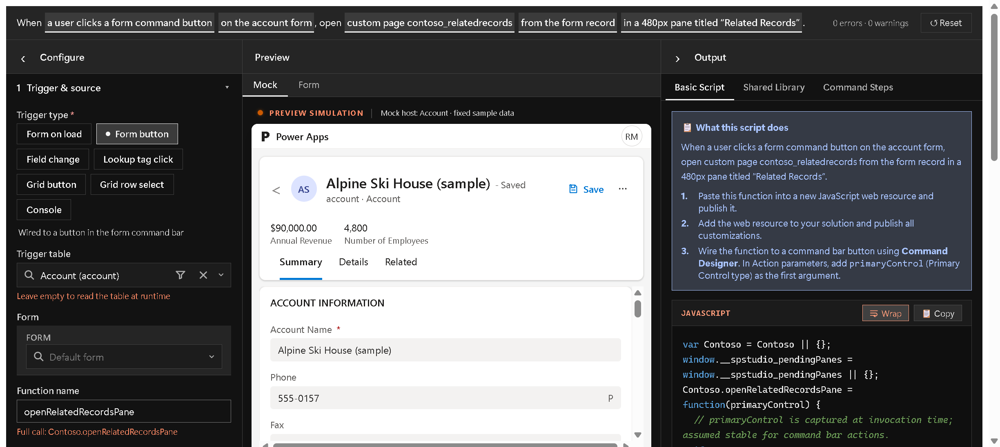
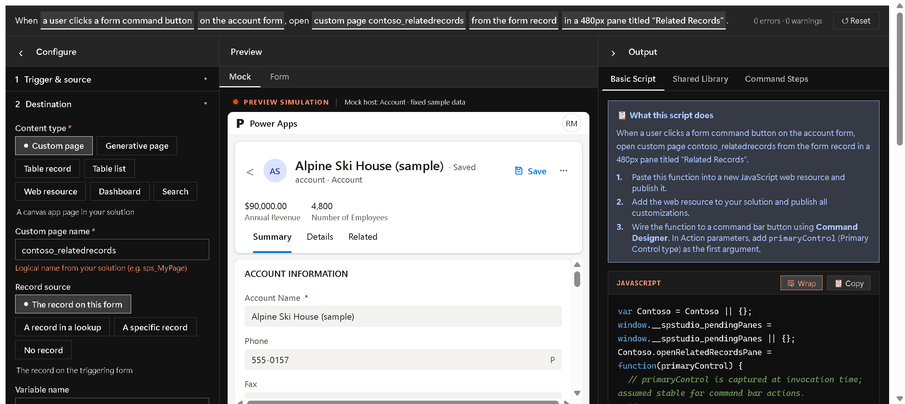
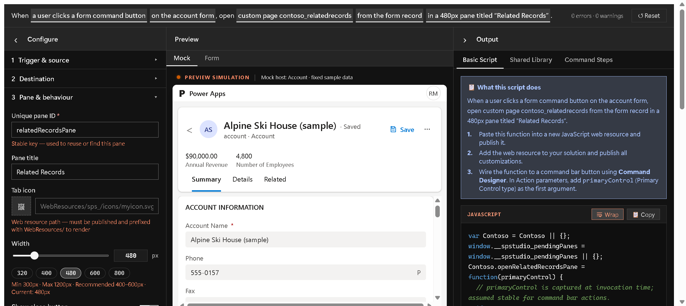
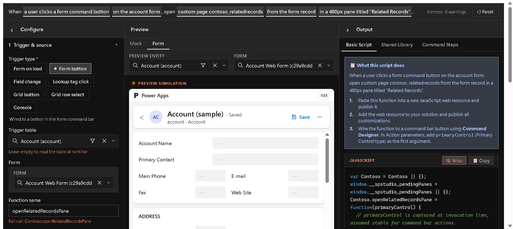
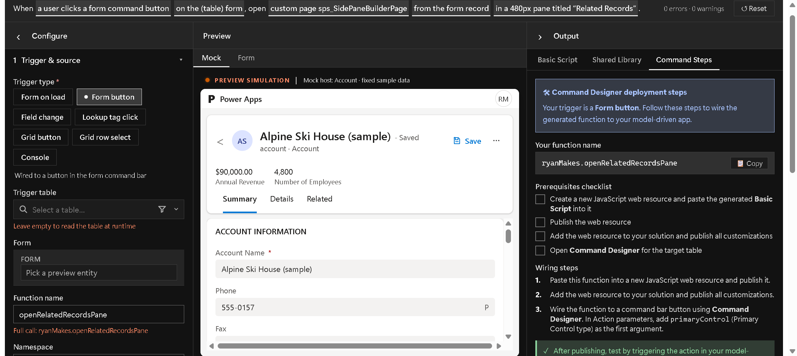

# Side Pane Studio Basic Usage Guide

This guide walks through the common workflow for creating a model-driven app
side pane with Side Pane Studio. The full instruction manual, including setup
and troubleshooting, is [user-manual.md](https://github.com/RyanMakesAndBreaksStuff/SidepaneStudio_PPTB/blob/main/documentation/user-manual.md).

## 1. Open Side Pane Studio

1. Open Power Platform Toolbox.
2. Connect to the Dataverse environment that contains your model-driven app.
3. Launch Side Pane Studio from the toolbox.
4. Confirm the tool shows an active Dataverse connection.

If the tool reports that `toolboxAPI` is unavailable, reopen it from inside
PPTB. If it reports no active Dataverse connection, reconnect the environment
in PPTB and retry.

If you saved the configuration while another environment was active, a warning
bar above the panels reads "This configuration was saved for a different
environment; table, form, view and page selections are unverified." Until you
select **Use anyway**, the table, form, view or page you picked there is
flagged ("This table was picked in a different environment. Confirm it exists
here.") and **Copy** is disabled on every code block. Picking the table, form,
view or page again also confirms it, as does **Reset**.

## 2. Choose the trigger and its table

Open **Trigger & source** in the Configure panel. Choose **Trigger type** first;
every other choice on the panel is limited to what that trigger can do.

- **Form on load** - opens the pane when a record form loads.
- **Form button** - wires the pane to a form command bar button.
- **Field change** - registers a column change handler.
- **Lookup tag click** - cancels the lookup's default navigation and opens the
  pane for the clicked lookup tag.
- **Grid button** - wires the pane to a command bar button on a main grid or
  subgrid.
- **Grid row select** - opens the pane when one row is selected (needs the Power
  Apps grid control).
- **Console** - creates code you can paste into the browser console.

Then fill in the fields the trigger shows:

- **Grid surface** (grid triggers) - **Main grid** or **Subgrid**.
- **Trigger table** - the table of the form, or of the grid the command or row
  event belongs to. Leave it empty on a form trigger to read the table at
  runtime.
- **Form** (Form on load, Form button) or **View** (grid triggers) - the form or
  view used by the previews.
- **Column** (Field change) - the column to watch, picked from metadata.
- **Lookup controls** (Lookup tag click) - add one or more lookup controls from
  metadata; remove one with the button beside its name.
- **Function name** and **Namespace** - match your solution naming conventions.

For Lookup tag click, add the generated `register…` function to form OnLoad with
**Pass execution context as first parameter** on; it registers the handler on
each listed control and is safe to run more than once. The generated handler
calls `preventDefault()` synchronously and reads the clicked tag with
`getTagValue()`.

## 3. Choose what opens and which record

Open **Destination**. Choose the **Content type**:

- **Custom page** - opens a custom page from the current solution.
- **Generative page** - opens a page built by the app agent, by page ID.
- **Table record** - opens a Dataverse record.
- **Table list** - opens a Dataverse table list.
- **Web resource** - opens an HTML or JavaScript web resource.
- **Dashboard** - opens a system or personal dashboard.
- **Search** - opens global search results, optionally with pre-filled text.

Only the content types the trigger can use are offered. Fill in the required
fields for the selected content type. Table lists can include a configured
`viewId` and `viewType` (`savedquery` or `userquery`). Generative pages take a
page ID and optional JSON page data; they receive record context and data only
if the page's prompt accepts them (see **Output → Page prompt**).

For Table record, **Record** is **Open existing record** or **Create new
record**. Create opens a blank form that **Form data** pre-fills, together with
**Form** and **Tab name** for the destination. A form record or selected row as
the source also pre-fills the new record.

For the content types that take a record, **Record source** says where the
record ID comes from. Only the sources the trigger allows are listed:

- **The record on this form** - the record on the triggering form.
- **The selected row** - the first selected grid or subgrid row.
- **The clicked tag record** - the record the clicked lookup tag points to.
- **A record in a lookup** - the record a lookup on the trigger table points to;
  pick the **Lookup column**.
- **A specific record** - a fixed record; enter its **Record ID** (GUID), plus
  **Record table** for content types other than Table record.
- **No record** - opens the pane independently.

**Variable name** (default `recordId`) names the variable that holds the record
ID in the generated script. **Destination table** is picked when you create a
record or use a specific record, and otherwise shown as
`Destination table: <name>`, read from the form record, row, or lookup.

Changing the trigger snaps the source and content to values that are legal for
it. The console starts on **No record** wherever a record is optional. A Table
record opened from the console can only use **A specific record**, so **Record
ID** is reported as missing until you enter one.

## 4. Set the pane and its behaviour

Open **Pane & behaviour**:

- **Unique pane ID**, **Pane title**, **Tab icon**, and **Width**
- **Show close button** and **Hide header bar**
- **Advanced**: **Open in foreground (isSelected)**, **Keep loaded when
  inactive**, **Keep badge on select**, and **Initial badge value**
- **Expand pane on open**, **Close other side panes**, **Close if already open**,
  and **Reuse open pane**

Use a stable Pane ID if you want generated code to reuse or update the same
pane across multiple opens.

Enable **Reuse open pane** when the same pane should stay loaded instead of
being recreated. Reuse will navigate the existing pane to the new page, then
select it. For a command bar button, **Close if already open** closes the
pane instead of opening it again when the pane is already open. Use **Expand
pane on open** when the pane should become visible immediately after the
trigger runs.

## 5. Read the summary

The sentence in the summary strip above the three panels reads back what the
generated script does, for example "When a user clicks a form command button on
the account form, open the account record from the form record in a 480px pane
titled “Related Records”." Each highlighted phrase is a button that opens the
section holding that choice. To the right of the sentence the strip counts
errors and warnings, for example "2 errors · 0 warnings", and holds the
**Reset** button. Check that the sentence says what you intend before you copy
code.

## 6. Preview the Pane

Use the preview area before copying code:

1. Open the mock preview to check pane layout, title, width, and behavior.
2. Use the form preview when connected metadata and form XML are available.
3. Adjust configuration until the pane looks correct for the target app.

Preview metadata shows configured table-list `viewId` and table-record
`formId`/`tabName` values when present. The mock metadata is not a live
navigation test. The form preview host's `FormSelector` remains independent
of the pane target's configured form.

The preview is for validation and layout confidence. Always test generated
code in the target model-driven app before shipping.

## 7. Generate and Deploy Code

1. Open the Output panel.
2. Review validation messages and fix required fields.
3. Copy the generated JavaScript.
4. Add the code to the appropriate web resource or command action.
5. Publish the solution customizations.
6. Test the trigger in the model-driven app.

For quick experiments, use the **Console** trigger and paste the
generated code into the browser developer console while the model-driven app is
open. Console output needs a **Function name** and a **Namespace** like every
other trigger: it defines `Namespace.functionName` and calls it, so pasting it
opens the pane.

## Troubleshooting

- **No connection** - reconnect the Dataverse environment in PPTB.
- **Missing metadata** - confirm the table exists and the current user can read it.
- **Pane does not open** - check the trigger function name, namespace, and command
  wiring.
- **Wrong record opens** - review the **Record source** and the trigger.
- **Code validation fails** - complete all required fields shown in the Configure
  panel before copying output.
- **Lookup tag does not register** - add the generated `register…` function
  to form OnLoad with execution context, and check the browser console for a
  missing-control warning.
- **Preview differs from the app** - local tests and preview do not replace a
  target model-driven-app test in a connected Dataverse environment.
